# Caderno de Leitura: a small almanac

A local reading notebook for one reader. It tracks what you read each day, keeps your notes
page by page, reads PDF and EPUB files, and asks you, when a book ends, how it changed you.

Everything runs on your own computer: one Node.js process, one SQLite file, no account, no
network calls while you use it. The screenshots below use an invented reading life
(public-domain books); they are made by `node scripts/showcase.mjs`.

## A day with the notebook

### 1. Open it, and the book you are reading is first

Today shows the main book with a "Continue reading" button, the daily goal (25 pages), the
streak, a calendar of the month and the last seven days. If a finished book still has no
closing report, a quiet reminder appears under it.


### 2. The reading desk and the library

Books being read sit on a desk: one main book (the default for logging and reading) and
the others, which can be moved or made main. Paused books wait below. Finished books move to a
library with the day they were finished.

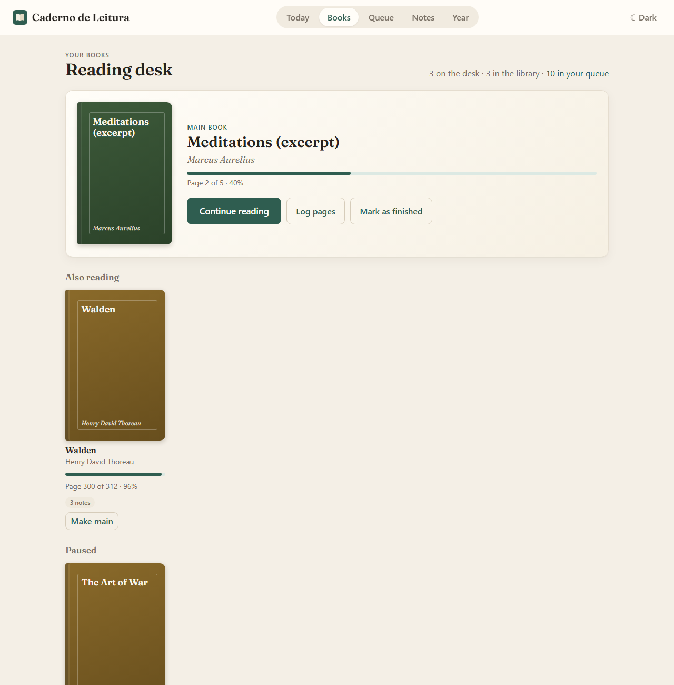

### 3. A queue of what comes next

A list of the books you plan to read, in order. It can be filled from a plain text file
(`[ ] 1. Title — Author`), skips books that already exist (even under a translated title),
and is reordered by holding a handle and dragging. A book started from the queue can return to
its own place.

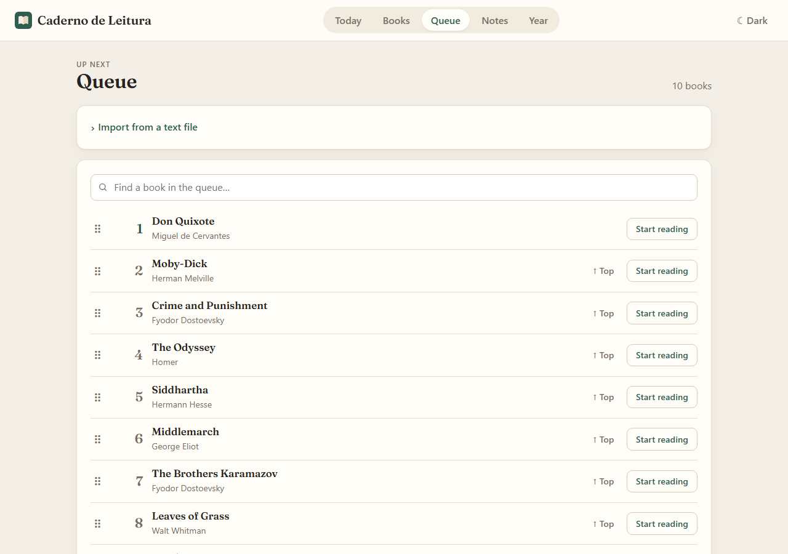

### 4. Log pages and keep notes

Each book has its own page: log a reading (pages count both ends), see the history, write
notes by page. Finished books can have their date corrected and their notes exported as
Markdown.

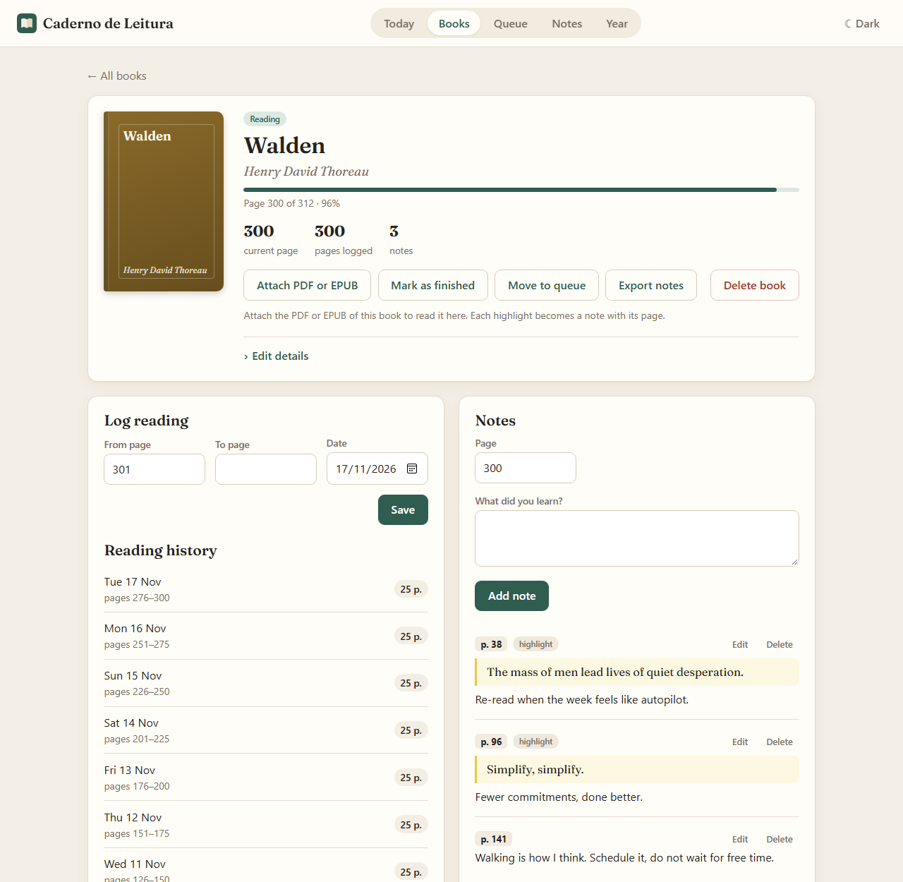

### 5. Read in the app, highlight, and the highlight becomes a note

PDF and EPUB open in a continuous-scroll reader. Select a sentence and it is saved as a
note with its page and a yellow mark; click a note later and the reader opens at that place.
Leaving the reader offers to log the pages you just read.

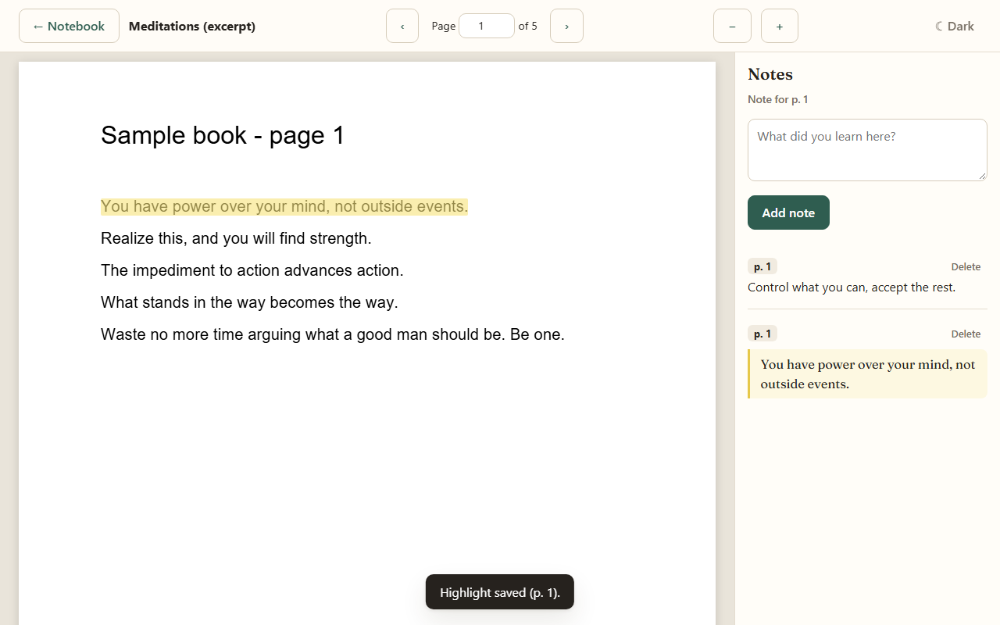

### 6. Closing a book

Finishing is a small ritual. First you read your notes again and pick up to three as the best.
Then you write the report: what the book is about, the ideas to keep, how it changed you
(the one required answer), a rating, and who you would recommend it to. You can still finish
without the report; the book then shows "Report owed" until you write it.

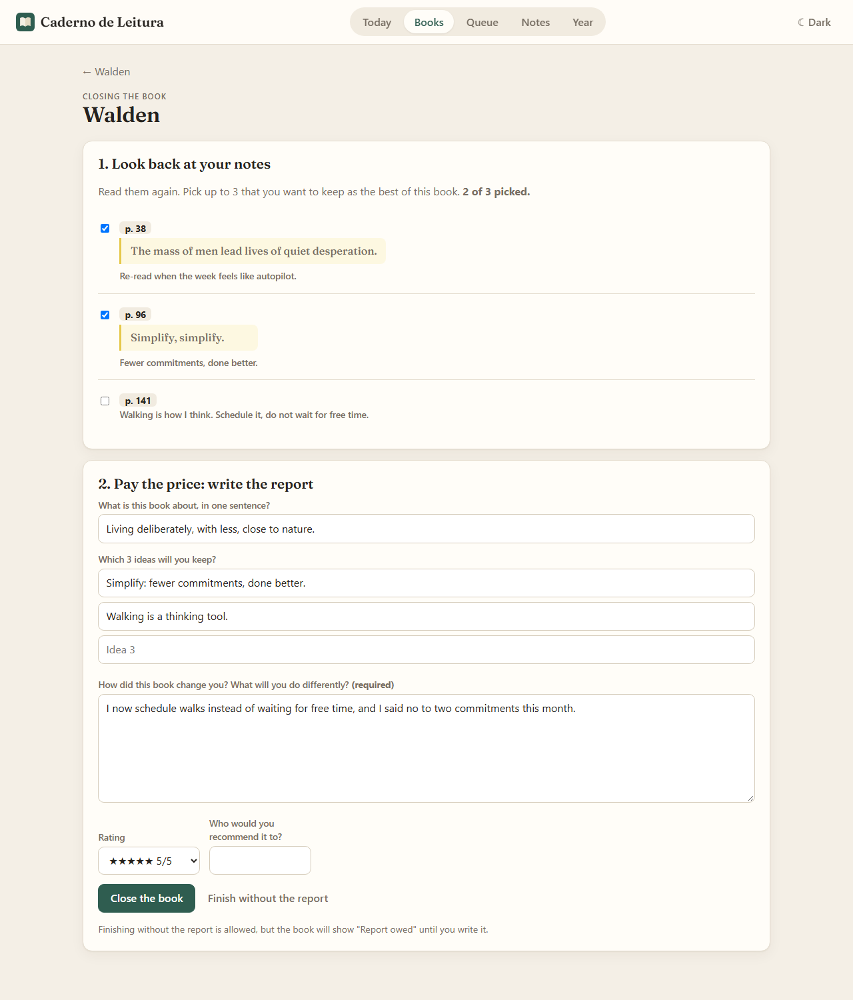

The report stays on the book page and goes into the notes export.

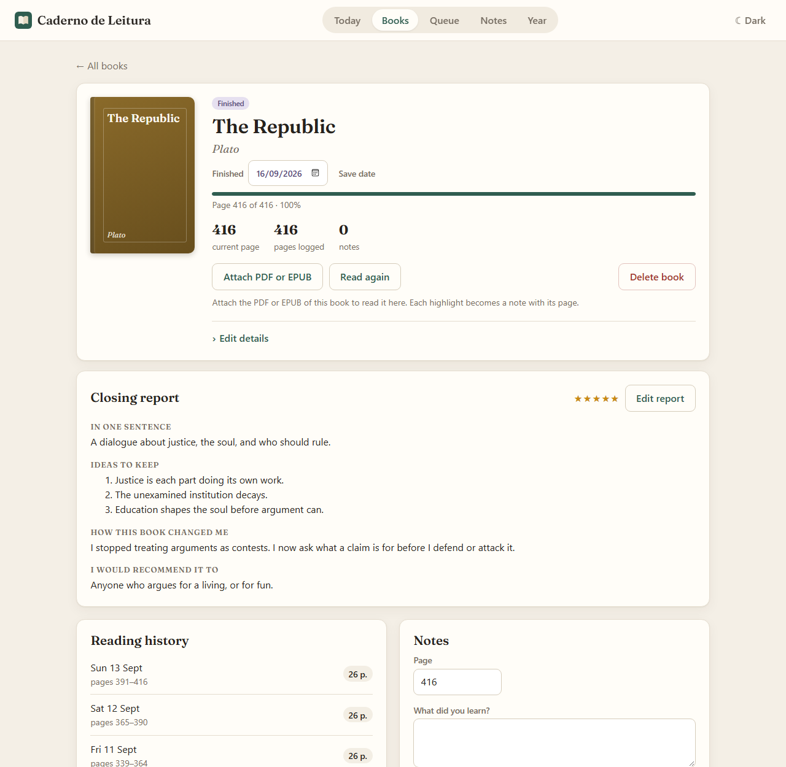

### 7. Your year in reading

A slideshow computed only from your own data: books finished, pages, longest streak, strongest
month, author of the year, favorites, best notes, and how your books changed you.

| Books | Rhythm | Changed me |
|---|---|---|
| 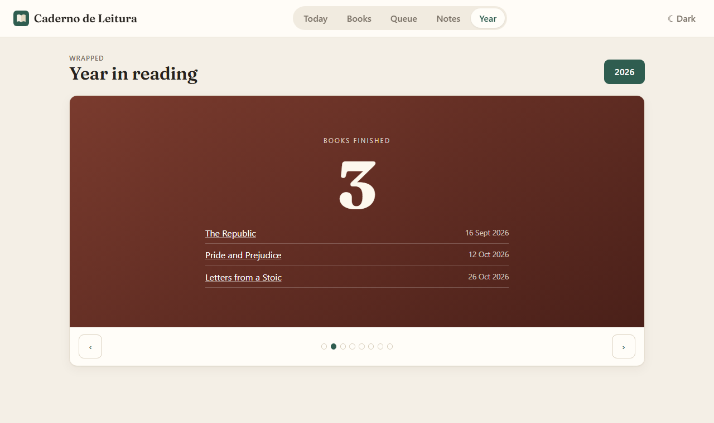 | 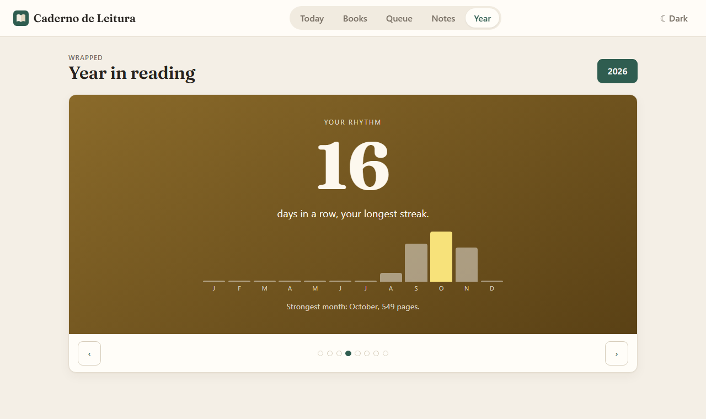 | 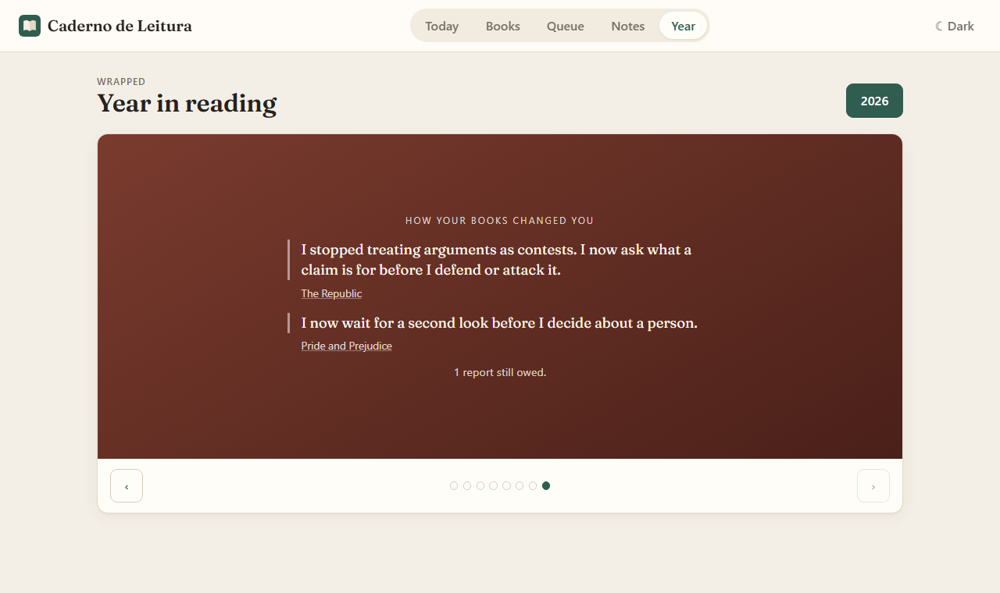 |

### 8. Dark mode and phones

The app follows the computer's light or dark setting, with a button to choose. In the reader
the EPUB text takes the dark colors, and PDF pages (pictures) can be inverted. The layout
holds on a phone.

| Dark | Dark reader | Phone | Phone queue |
|---|---|---|---|
| 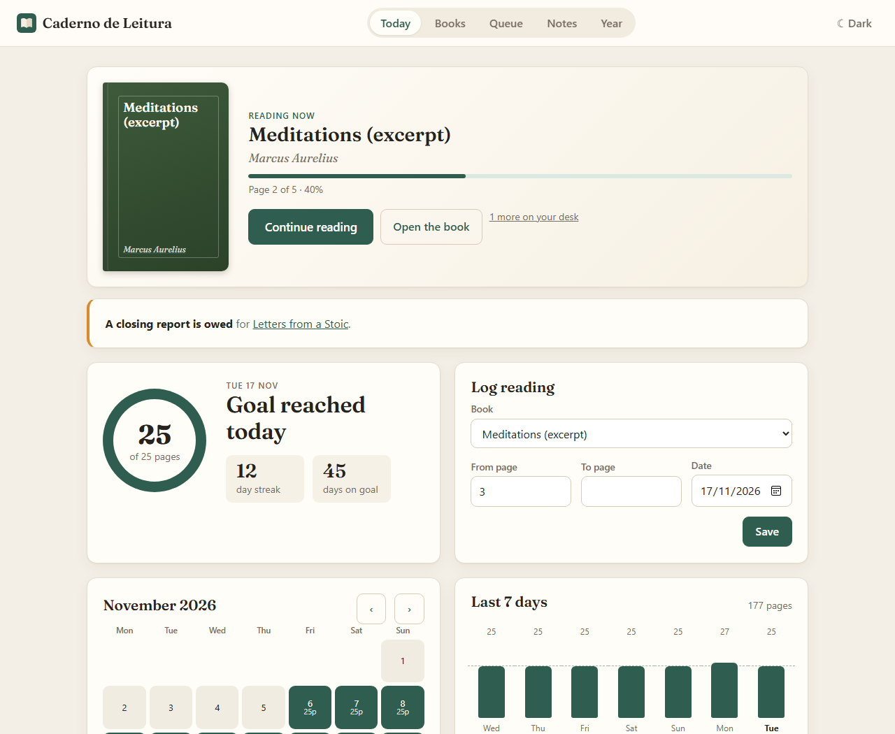 | 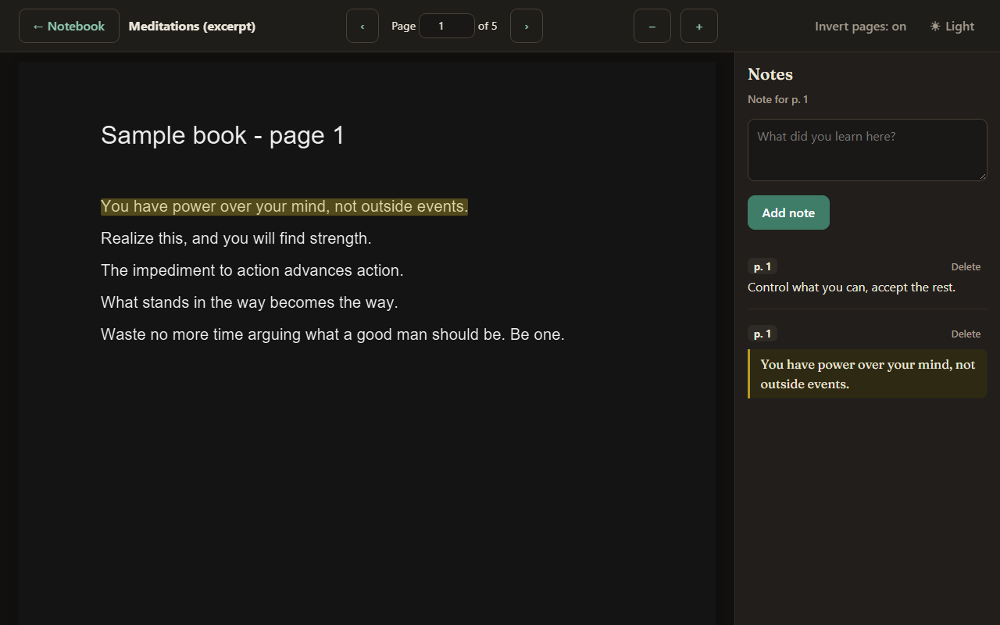 | 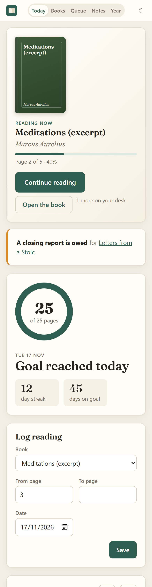 | 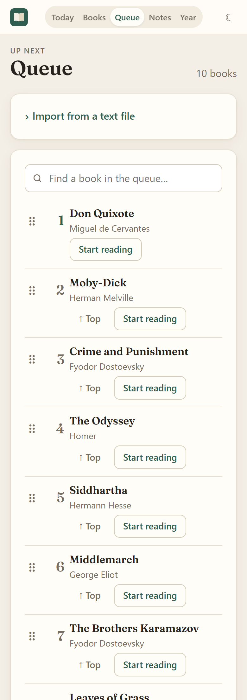 |

## Under the hood

- **Stack:** Node.js 24 only, using its built-ins (`node:http`, `node:sqlite`, `node:test`).
  Plain JavaScript modules in the browser, no framework, no build step, no TypeScript. The
  only runtime dependencies are the PDF and EPUB libraries and one font, served from
  `node_modules` so the app makes no network calls.
- **Private by construction:** the server listens on `127.0.0.1` only. The data lives in one
  folder that is never committed.
- **Data safety:** the database has versioned migrations, and every upgrade first saves a
  copy and runs inside a transaction that rolls back on any broken link. A copy is also made
  once a day (the last 14 are kept). "Delete" moves a book to a trash for 30 days.
- **Honest page numbers:** an EPUB shows the printed edition's page when the file has them;
  otherwise the app counts pages itself and says so ("counted by the app").
- **Tests:** 39 automated tests (`npm test`) run the API against a real server and a real
  temporary database, including upgrades of old databases and a queue import of 307 lines.
- **Reproducible screenshots:** `scripts/showcase.mjs` seeds a temporary notebook, drives a
  headless Edge or Chrome over the DevTools Protocol, and writes the images. It never touches
  real data.

## Run it

```bash
npm install
npm start
```
